# Firka iOS-re

| <sub>HU</sub> [Magyar](README.md) | <sub>EN</sub> [English](README_en.md) |
|-----------------------------------|---------------------------------------|

A [Firka](https://github.com/QwIT-Development/firka), a QwIT Development nem hivatalos KRÉTA-kliense, újraírva natív SwiftUI-ban, iPhone-ra.

> **Nem hivatalos, saját átirat.** Ezt az iOS-változatot nem a QwIT Development vagy a Firka csapata készíti, tartja karban vagy támogatja, és nem az App Store-ból terjed. A hibáit kérlek, ne a Firka projektnek jelentsd. Az eredeti alkalmazásért, a dizájnért és a KRÉTA-kutatásért minden elismerés a QwIT Developmentet illeti.

**Licenc:** CC BY-NC-SA 4.0, ugyanaz, mint az eredetié (lásd `LICENSE.txt`). Nem adhatod el, és a módosításaidat ugyanezzel a licenccel, a QwIT Development feltüntetésével kell megosztanod. A projekt nem áll kapcsolatban az eKRÉTA Informatikai Zrt.-vel.

## Képernyőképek

Demó adatokkal (debug buildben: Demó mód a bejelentkező képernyőn, vagy `FIRKA_DEMO=1`), iPhone 11 Pro Maxon.

<p>
  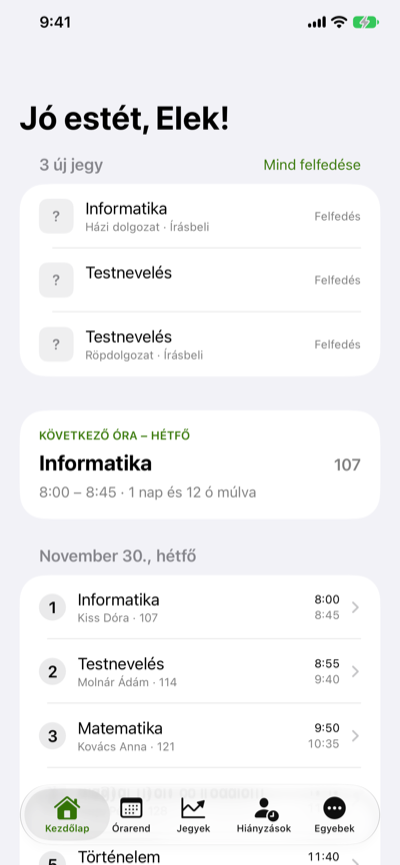
  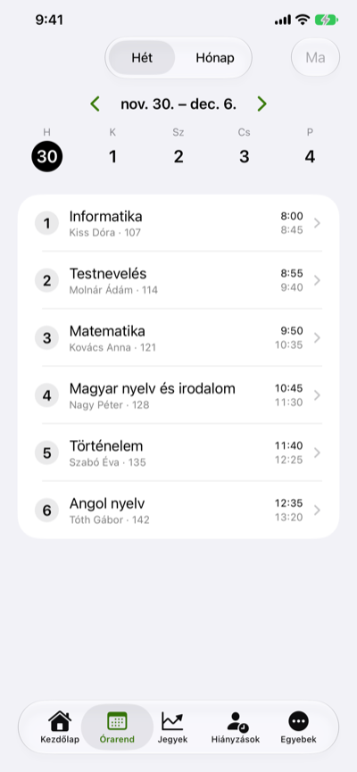
  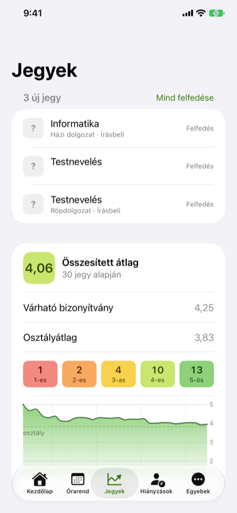
  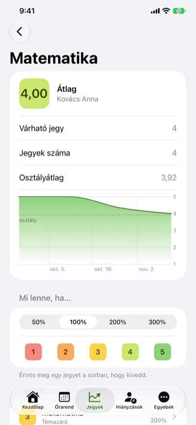
</p>
<p>
  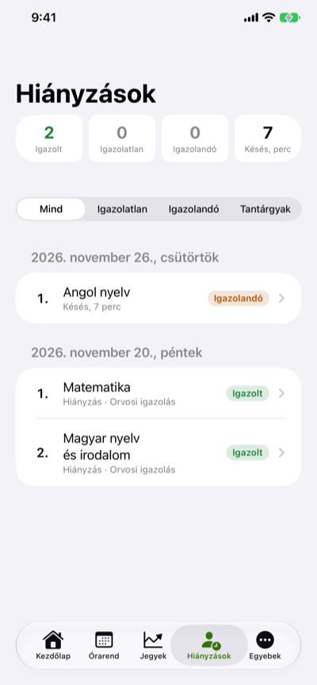
  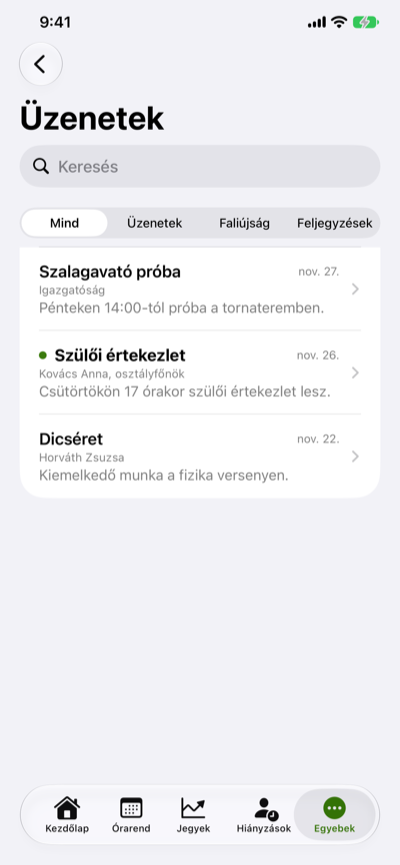
  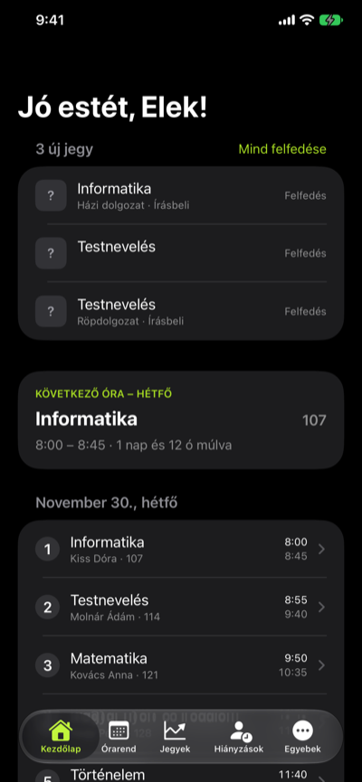
</p>

### Egyetem (Neptun)

Csak ezen az ágon, valódi adaton még nem kipróbálva (lásd `NEPTUN_PLAN.md`). Demó adatok: `FIRKA_DEMO=neptun`.

<p>
  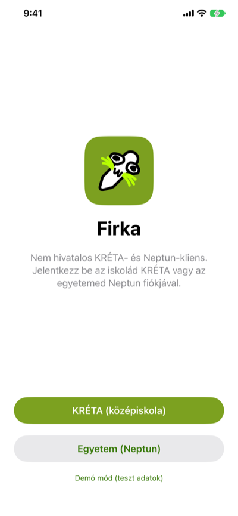
  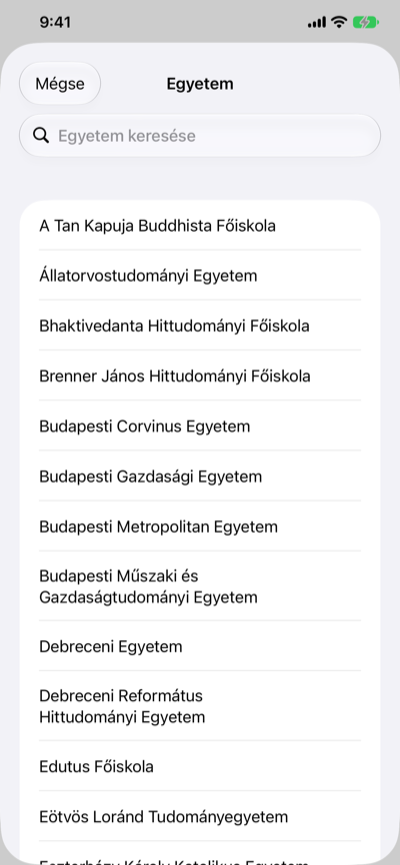
  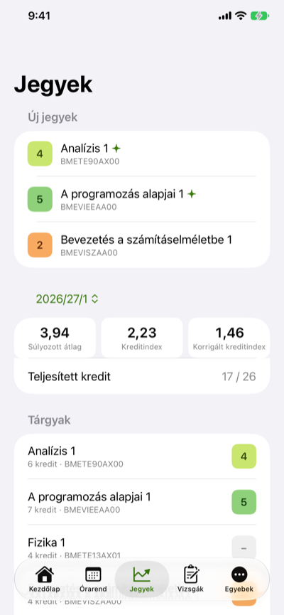
</p>
<p>
  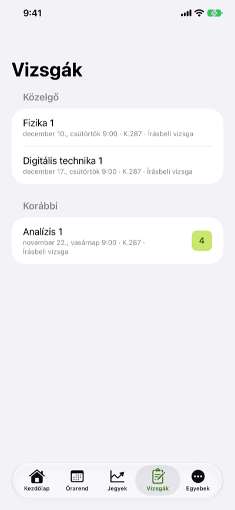
  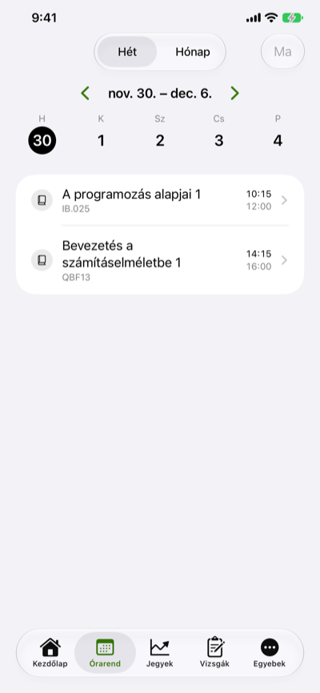
</p>

## Mit tud?

- KRÉTA-bejelentkezés (a hivatalos OAuth-oldalon, automatikus tokenmegújítással)
- Kezdőlap: a mostani vagy a következő óra visszaszámlálással, a mai órák, a közelgő számonkérések, házik és a legutóbbi jegyek
- Órarend: heti és napi nézet, a napok között húzással lapozhatsz; az elmaradt óra piros, a helyettesítés narancs
- Jegyek: összesített és tantárgyankénti átlag, átlaggrafikon az idő függvényében, jegyeloszlás, „Mi lenne, ha…” kalkulátor
- Hiányzások: igazolt, igazolatlan és igazolandó hiányzások, plusz a késések percben
- Házi feladatok, számonkérések, faliújság, tanári feljegyzések és tanári üzenetek (KRÉTA postaláda), a mellékleteket meg is nyithatod és megoszthatod
- Havi órarend pöttyökkel az órákhoz, számonkérésekhez, változásokhoz és iskolai eseményekhez
- Tantárgyak és tanárok átnevezése (Egyebek › Tantárgyak, tanárok átnevezése); az új név mindenhol megjelenik, a widgetben és az értesítésekben is
- A KRÉTA-ban szereplő, de valójában meg nem tartott órák elrejtése: húzd balra az órát (vagy nyomd hosszan, vagy használd az óra oldalán a gombot); csak azt az egyet, minden héten, vagy az egész tantárgyat. Az elrejtett óra a kezdőlapról, a widgetből, a Live Activityből és az értesítésekből is eltűnik; az Egyebek › Elrejtett órák alatt találod meg őket
- Bizonyítvány nézet (amint van félévi vagy év végi jegy): félévi és év végi jegyek tantárgyanként, és a várható jegy ott, ahol még nincs
- Állítható kerekítési határok, várható tantárgyi jegyek és várható bizonyítványátlag
- Osztályátlag tantárgyanként és összesítve, a grafikonokon szaggatott vonalként is
- Meglepetésjegyek: az új jegyek „?”-ként várnak a kezdőlapon; egy koppintás felfedi, és megmutatja, mit tett a tantárgy átlagával. Ha nem vagy felkészülve, nem kell egyszerre szembenézned mindegyikkel
- Értesítések új jegyről, elmaradt óráról, helyettesítésről, házi feladatról, számonkérésről, hiányzásról és üzenetről (háttérfrissítéssel, vagyis az időzítést az iOS dönti el)
- Widget a kezdőképernyőre és a zárolási képernyőre a következő órával
- Live Activity tanítási napokon: a mostani vagy következő óra visszaszámlálással a zárolási képernyőn, és óránként egy magától telő sáv (a Beállításokban ki-be kapcsolható)
- Internet nélkül is működik a legutóbb letöltött adatokkal

## Telepítés iPhone-ra ingyenes Apple ID-vel

Kell hozzá egy Mac Xcode-dal, egy USB-kábel és egy legalább iOS 18-as iPhone.

1. Nyisd meg a `Firka.xcodeproj`-ot Xcode-ban.
2. Menj az **Xcode → Settings → Accounts** pontra, kattints a **+** gombra, és add hozzá az Apple ID-det.
3. Hozd létre a `Config/Local.xcconfig` fájlt (ez nem kerül gitbe) a saját bundle id-ddel és csapatoddal:
   ```
   APP_ID = hu.yourname.firka
   DEVELOPMENT_TEAM = ABCDE12345
   ```
   A csapatazonosítót Xcode-ban a **Settings → Accounts → az Apple ID-d** alatt találod (Personal Team). Az `APP_ID`-nek egyedinek kell lennie; ebből lesz a widget bundle id-ja és az App Group is. A csapatot ne az Xcode Signing fülén válaszd ki: az a közös projektfájlba írná bele.
4. Zárd be és nyisd meg újra a projektet, hogy az Xcode beolvassa a fájlt.
5. Csatlakoztasd az iPhone-t kábellel, oldd fel, és koppints rajta a **Megbízom** gombra. Az Xcode ablak tetején válaszd ki az iPhone-t futtatási célnak.
6. Az iPhone-on kapcsold be a **Beállítások → Adatvédelem és biztonság → Fejlesztői mód** opciót. Ez az 5. lépés után jelenik meg. A telefon újraindul; erősítsd meg a **Bekapcsolás** gombbal.
7. Nyomd meg Xcode-ban a **Run** gombot (⌘R). Az első telepítés megállhat egy „nem megbízható fejlesztő” üzenettel: ilyenkor az iPhone-on menj a **Beállítások → Általános → VPN és eszközkezelés** pontra, koppints az Apple ID-dre, majd a **Megbízom** gombra. Nyomd meg újra a Run gombot.
8. Nyisd meg a Firkát, jelentkezz be, és engedélyezd az értesítéseket. A widgetet a kezdőképernyőről adhatod hozzá: nyomj hosszan egy üres helyre → **Szerkesztés** → **Widget hozzáadása** → Firka.

**Az ingyenes Apple ID korlátai:** az app **7 nap** után nem indul el. Ilyenkor csatlakoztasd a telefont, és nyomd meg újra a Run gombot; a bejelentkezés és az adatok megmaradnak. Ingyenes fiókkal egyszerre legfeljebb 3 saját app lehet a telefonon. Az App Group (ez kell a widgethez) és a háttérfrissítés ingyenes fiókkal is működik.

### Automatikus heti megújítás

A `scripts/renew-on-iphone.sh` újraaláírja és újratelepíti az appot, mielőtt letelne a 7 nap. Naponta 9:00-kor és 19:00-kor fut, és addig nem csinál semmit, amíg 3 napnál több van hátra. Másold a `scripts/renew.local.example.sh` fájlt `scripts/renew.local.sh` néven, és írd bele az iPhone-od azonosítóját (egy második appot is életben tarthat). Utána egyszer telepítsd az ütemezést:

```bash
scripts/install-renew-schedule.sh
```

Amire szüksége van: a Mac legyen ébren és bejelentkezve, az iPhone ugyanazon a Wi-Fi-n (vagy kábelen), lehetőleg feloldva. Ha a Mac aludt az időpontban, ébredéskor fut le. Értesítést küld, ha megújított, vagy ha egy napnál kevesebb volt hátra, és nem érte el a telefont. Napló: `~/Library/Logs/firka-renew.log`. Azonnali megújítás: `scripts/renew-on-iphone.sh --force`. Kikapcsolás: `scripts/install-renew-schedule.sh --remove`.

## Fejlesztés

- **Tesztek:** Xcode-ban ⌘U, vagy futtasd le mindazt, aminek egy kiadás előtt át kell mennie (unit- és UI-tesztek a szimulátorban, aztán Release build iPhone-ra):
  ```bash
  scripts/test.sh
  ```
  Két réteg, mindkettőt a `scripts/test.sh` futtatja (`FAST=1` csak a unit teszteket):
  - `FirkaTests/` (Swift Testing, unit): minden képernyő, a widget és a Live Activity mögötti logika (`TimetableNav`, `ScreenLogic.swift`, `Notifier.changes`, `Grades.swift` …), és a KRÉTA-kliens egy hamis szerver ellen (`Stub.swift`: egy `URLProtocol`, amely minden `*.e-kreta.hu` kérésre válaszol, így a címek, fejlécek, tokenmegújítás, hibakezelés és az egész szinkron internet nélkül tesztelhető). A kulcstartót, a gyorsítótár-fájlt vagy a UserDefaultst használó tesztek a sorban futó `Global` csomagban vannak, és visszaállítják, amit módosítanak.
  - `FirkaUITests/` (XCUITest): a valódi app demó módban (`FIRKA_DEMO=1`): fülek, hétsáv, meglepetésjegyek, óra elrejtése, üzenetek, kijelentkezés.

  Tesztvezérelt fejlesztés: minden változtatás egy bukó teszttel kezdődik, minden hiba egy azt előidéző teszttel (lásd CLAUDE.md).
- A debug buildekben a bejelentkező képernyőn van egy **Demó mód** gomb kitalált adatokkal, így KRÉTA-fiók nélkül is kipróbálhatod az appot.
- Az app naplója (hibák, frissítések összegzése, osztályátlagok letöltése), amíg a szimulátorban fut:
  ```bash
  xcrun simctl spawn booted log stream --level info --predicate 'subsystem == "firka"' --style compact
  ```
- Csak debug buildben elérhető indítási kapcsolók, hogy ne kelljen valódi eseményekre várni:
  ```bash
  SIMCTL_CHILD_FIRKA_FORCE_REFRESH=1 xcrun simctl launch booted <APP_ID>
  ```
  ```bash
  SIMCTL_CHILD_FIRKA_HIDE_NEWEST=3 xcrun simctl launch booted <APP_ID>
  ```
  `FIRKA_ACTIVITY_DEMO=1` (vagy `=break`): a Live Activity egy kitalált nappal, épp óra (vagy szünet) közben. `FIRKA_FORCE_REFRESH`: lejártnak veszi a tokent, így a következő szinkronnak meg kell újítania. `FIRKA_HIDE_NEWEST=N`: a legújabb N jegyet újra meglepetésnek rejti. `FIRKA_DEMO=1`: tiszta lappal indul demó módban (a UI-tesztek ezt használják). `FIRKA_PROBE=1`: a nyers KRÉTA-válaszokat az app Documents/probe mappájába menti (a valódi adatok tanulmányozásához). Release buildben egyik sem létezik.
- A `Firka/`, `FirkaWidget/`, `Shared/`, `FirkaTests/` és `FirkaUITests/` mappák fájljait az Xcode magától felveszi. A `Shared/` az appba és a widgetbe is belefordul.
- Az összes beállítás kulcsa a `Firka/Prefs.swift`-ben van.

## Kiadás előtti ellenőrzőlista

- A `scripts/test.sh` hiba nélkül lefut.
- Növeld a `MARKETING_VERSION`-t (TestFlighthoz a `CURRENT_PROJECT_VERSION`-t is) a projekt build-beállításaiban.
- Ami az App Store-hoz / TestFlighthoz már megvan (ehhez fizetős fejlesztői fiók kell): adatvédelmi manifeszt (`Firka/PrivacyInfo.xcprivacy`: nincs követés, nincs adatgyűjtés, a UserDefaults csak saját beállításokra), `ITSAppUsesNonExemptEncryption = NO` (csak HTTPS), appikon, csak álló, csak iPhone-os build.
- A licenc CC BY-NC-SA 4.0: nincs fizetős terjesztés, és a QwIT Development feltüntetése kötelező.

| Fájl | Mit csinál |
|---|---|
| `Firka/Kreta.swift` | API-modellek, OAuth + PKCE, token a kulcstartóban, API-kliens |
| `Firka/Store.swift` | Gyorsítótár, frissítés, értesítési szabályok (`Notifier.changes`), háttérfeladat |
| `Firka/Grades.swift` | Átlagok, kerekítési határok, bizonyítvány, felfedési megjegyzések (ugyanazok a szabályok, mint a firkában) |
| `Firka/HiddenLessons.swift` | A meg nem tartott órák elrejtésének szabályai (felület: `HiddenLessonsUI.swift`) |
| `Firka/Renames.swift` | Saját nevek tantárgyaknak és tanároknak |
| `Firka/SurpriseGrades.swift` | A meglepetésjegyek rész a kezdőlapon és a Jegyek oldalon |
| `Firka/LiveActivity.swift` | A Live Activity indítása, frissítése, leállítása (nézetek: `FirkaWidget/LessonLiveActivity.swift`) |
| `Firka/ServerPush.swift` | Értesítések a saját szerverről (`server/push`): beállítások szinkronja, állapot, tesztgomb |
| `Firka/*View.swift`, `Rows.swift`, `DetailViews.swift` | A képernyők, mindegyik külön fájlban (logika: `ScreenLogic.swift`); a több helyen használt sorok és részletes oldalak |
| `FirkaWidget/FirkaWidget.swift` | A widget |
| `Shared/` | Az app és a widget közös kódja (órák a widgetnek, színek, dátumok) |
