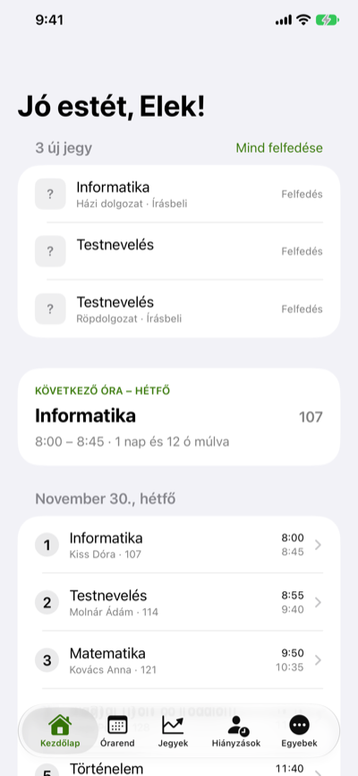
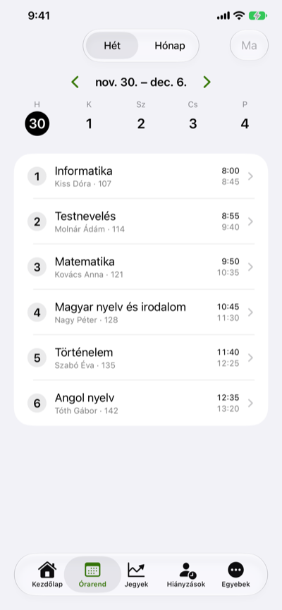
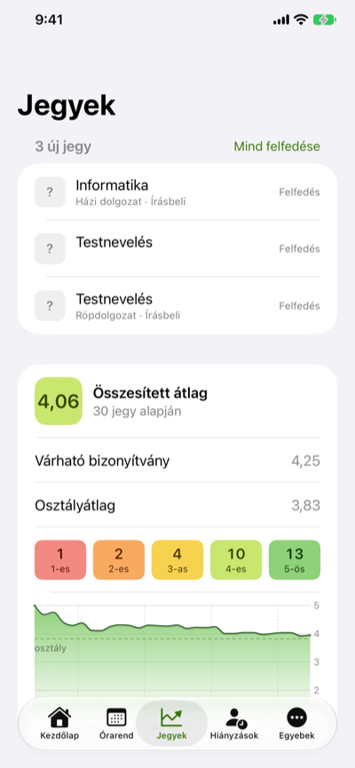
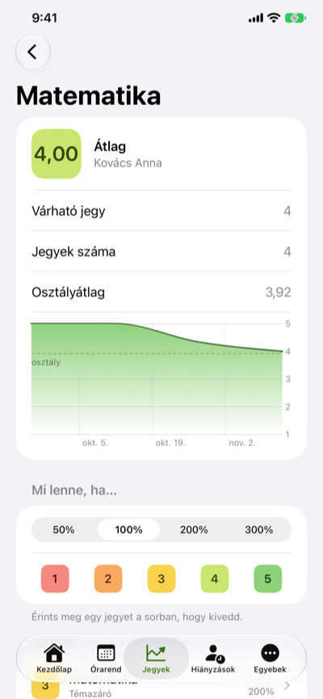
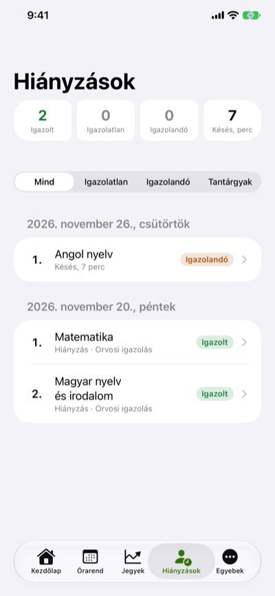
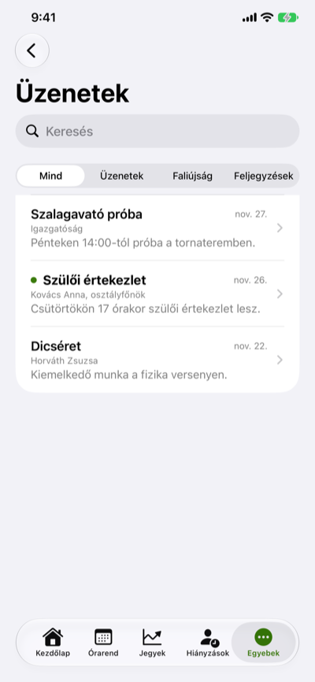
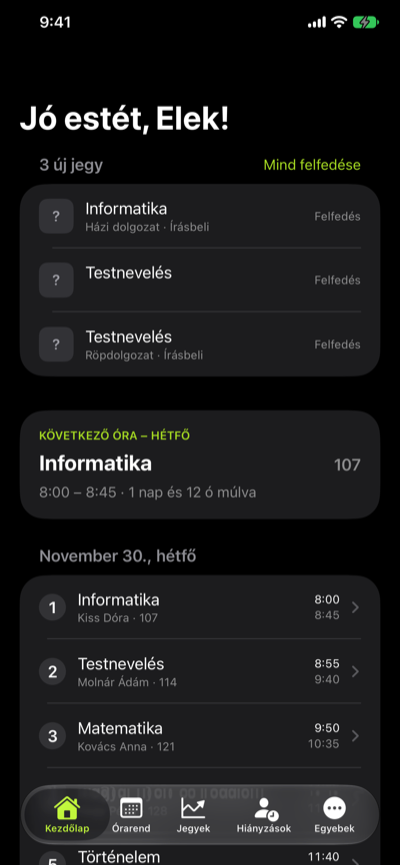

# Firka for iOS

| <sub>HU</sub> [Magyar](README.md) | <sub>EN</sub> [English](README_en.md) |
|-----------------------------------|---------------------------------------|

A native SwiftUI rewrite of [Firka](https://github.com/QwIT-Development/firka), the unofficial KRÉTA school-diary client by QwIT Development, built for iPhone.

> **Unofficial, personal port.** This iOS version is not made, maintained or endorsed by QwIT Development or the Firka team, and isn't distributed through the App Store. Please don't report its problems to the Firka project. Credit for the original app, its design and its KRÉTA research goes to QwIT Development.

**License:** CC BY-NC-SA 4.0, the same as the original (see `LICENSE.txt`). You can't sell it, and you have to share changes under the same license with credit to QwIT Development. This project is not affiliated with eKRÉTA Informatikai Zrt.

## Screenshots

Demo data (debug builds: Demó mód on the login screen, or `FIRKA_DEMO=1`), iPhone 11 Pro Max.

<p>
  
  
  
  
</p>
<p>
  
  
  
</p>

## What's in it

- KRÉTA login (official OAuth page, with automatic token refresh)
- Home: current or next lesson with a countdown, today's lessons, upcoming tests, homework and recent grades
- Timetable: by week and day, swipe between days; cancelled lessons in red, substitutions in orange
- Grades: overall and per-subject averages, average-over-time chart, grade distribution, "what if" calculator
- Absences: excused, unexcused and pending absences, plus lateness minutes
- Homework, tests, notice board, teacher notes, and teacher messages (KRÉTA postaláda) with attachments you can open and share
- Month view of the timetable with dots for lessons, tests, changes and school events
- Rename subjects and teachers (Egyebek › Tantárgyak, tanárok átnevezése); the new names show everywhere, widget and notifications included
- Hide lessons that KRÉTA lists but aren't held: swipe a lesson left (or long-press, or the button on the lesson screen); just that one, every week, or the whole subject. Hidden lessons also stay off the home screen, widget, Live Activity and notifications; Egyebek › Elrejtett órák lists them
- Report card view (once a half-year or year-end grade exists): half-year and year-end grades per subject, with the expected grade where none is given yet
- Adjustable rounding thresholds, expected subject grades and expected report-card average
- Class averages per subject and overall, also shown as a dashed line on the charts
- Surprise grades: new grades sit as "?" on the home screen; a tap reveals one and shows what it did to the subject average
- Notifications for new grades, cancelled lessons, substitutions, homework, tests, absences and messages (background refresh, so iOS picks the timing)
- Home-screen and lock-screen widget showing the next lesson
- Live Activity on school days: the current or next lesson with a countdown on the lock screen, and a bar per lesson that fills itself (on/off in Settings)
- Works offline using the last data it downloaded

## Install on your iPhone with a free Apple ID

Needs a Mac with Xcode, a USB cable, and an iPhone on iOS 18 or later.

1. Open `Firka.xcodeproj` in Xcode.
2. Go to **Xcode → Settings → Accounts**, click **+** and add your Apple ID.
3. Create `Config/Local.xcconfig` (it stays out of git) with your own bundle id and team:
   ```
   APP_ID = hu.yourname.firka
   DEVELOPMENT_TEAM = ABCDE12345
   ```
   The team id is in Xcode under **Settings → Accounts → your Apple ID** (Personal Team). `APP_ID` must be unique; it also sets the widget's bundle id and the App Group. Don't pick the team in Xcode's Signing tab instead: that writes it into the project file, which is shared.
4. Close and reopen the project so Xcode picks up the file.
5. Connect the iPhone with a cable, unlock it and tap **Trust** on it. Pick the iPhone at the top of the Xcode window as the run destination.
6. On the iPhone, turn on **Settings → Privacy & Security → Developer Mode**. It appears there after step 5. The phone restarts; confirm with **Turn On**.
7. Press **Run** (⌘R) in Xcode. The first install may stop with an "untrusted developer" message: on the iPhone go to **Settings → General → VPN & Device Management**, tap your Apple ID and then **Trust**. Press Run again.
8. Open Firka, log in, and allow notifications. Add the widget from the home screen: long-press an empty spot → **Edit** → **Add Widget** → Firka.

**Free Apple ID limits:** the app stops opening after **7 days**. Connect the phone and press Run again to renew it; your login and data are kept. A free account can have at most 3 of your own apps on the phone at a time. App Groups (needed by the widget) and background refresh both work with a free account.

### Automatic weekly renewal

`scripts/renew-on-iphone.sh` re-signs and reinstalls the app before the 7 days run out. It runs at 9:00 and 19:00 and does nothing until less than 3 days are left. Copy `scripts/renew.local.example.sh` to `scripts/renew.local.sh` and put your iPhone's id in it (it can also keep a second app alive). Then install the schedule once:

```bash
scripts/install-renew-schedule.sh
```

What it needs: the Mac awake and logged in, the iPhone on the same Wi-Fi (or on the cable) and preferably unlocked. If a scheduled time is missed because the Mac was asleep, it runs on wake. It shows a notification when it renews, or when the phone wasn't reachable with less than a day left. Log: `~/Library/Logs/firka-renew.log`. Renew right now: `scripts/renew-on-iphone.sh --force`. Turn it off: `scripts/install-renew-schedule.sh --remove`.

## Development

- **Tests:** press ⌘U in Xcode, or run everything that should pass before a release (unit and UI tests in the simulator, then a Release build for iPhone):
  ```bash
  scripts/test.sh
  ```
  Two layers, both run by `scripts/test.sh` (`FAST=1` runs the unit tests only):
  - `FirkaTests/` (Swift Testing, unit): the logic behind every screen, the widget and the Live Activity (`TimetableNav`, `ScreenLogic.swift`, `Notifier.changes`, `Grades.swift` …), and the KRÉTA client against a fake server (`Stub.swift`: a `URLProtocol` that answers every `*.e-kreta.hu` request, so URLs, headers, token renewal, error handling and the whole sync are tested without the internet). Tests that share the keychain, the cache file or UserDefaults sit in the serialized `Global` suite and restore what they change.
  - `FirkaUITests/` (XCUITest): the real app in demo mode (`FIRKA_DEMO=1`), tapping through the tabs, the week strip, surprise grades, hiding a lesson, messages and logout.

  Test-driven: a change starts with a failing test, a bug with a test that reproduces it (see CLAUDE.md).
- Debug builds have a **Demo mode** button on the login screen with fake data, so you can try the app without a KRÉTA account.
- Watch the app's log (errors, refresh summaries, class-average fetch) while it runs in the simulator:
  ```bash
  xcrun simctl spawn booted log stream --level info --predicate 'subsystem == "firka"' --style compact
  ```
- Debug-only launch switches, for testing without waiting on real events:
  ```bash
  SIMCTL_CHILD_FIRKA_FORCE_REFRESH=1 xcrun simctl launch booted <APP_ID>
  ```
  ```bash
  SIMCTL_CHILD_FIRKA_HIDE_NEWEST=3 xcrun simctl launch booted <APP_ID>
  ```
  `FIRKA_ACTIVITY_DEMO=1` (or `=break`) shows the Live Activity with a made-up day around now, during a lesson (or a break). `FIRKA_FORCE_REFRESH` treats the access token as expired, so the next sync has to renew it. `FIRKA_HIDE_NEWEST=N` hides the N newest grades again as surprise grades. `FIRKA_DEMO=1` starts over in demo mode (the UI tests use it). `FIRKA_PROBE=1` saves raw KRÉTA responses into the app's Documents/probe folder (for looking at real payloads). None of these exist in Release builds.
- Files in `Firka/`, `FirkaWidget/`, `Shared/`, `FirkaTests/` and `FirkaUITests/` are picked up by Xcode automatically. `Shared/` is compiled into both the app and the widget.
- Settings keys are all in `Firka/Prefs.swift`.

## Release checklist

- `scripts/test.sh` passes.
- Bump `MARKETING_VERSION` (and `CURRENT_PROJECT_VERSION` for TestFlight) in the project's build settings.
- Already in place for the App Store / TestFlight (needs the paid developer account): privacy manifest (`Firka/PrivacyInfo.xcprivacy`: no tracking, no data collected, UserDefaults for own settings), `ITSAppUsesNonExemptEncryption = NO` (only HTTPS), app icon, portrait-only iPhone build.
- The license is CC BY-NC-SA 4.0: no paid distribution, and keep the credit to QwIT Development.

| File | What it does |
|---|---|
| `Firka/Kreta.swift` | API models, OAuth + PKCE, token in the Keychain, API client |
| `Firka/Store.swift` | Data cache, refresh, notification rules (`Notifier.changes`), background task |
| `Firka/Grades.swift` | Averages, rounding thresholds, report card, reveal notes (same rules as firka) |
| `Firka/HiddenLessons.swift` | Rules for hiding lessons that aren't held (UI in `HiddenLessonsUI.swift`) |
| `Firka/Renames.swift` | Own names for subjects and teachers |
| `Firka/SurpriseGrades.swift` | Surprise grades section on the home and grades screens |
| `Firka/LiveActivity.swift` | Starts/updates/ends the Live Activity (views in `FirkaWidget/LessonLiveActivity.swift`) |
| `Firka/ServerPush.swift` | Notifications from the own server (`server/push`): settings sync, status, test button |
| `Firka/*View.swift`, `Rows.swift`, `DetailViews.swift` | The screens, one file each (logic in `ScreenLogic.swift`); rows and detail pages used on several |
| `FirkaWidget/FirkaWidget.swift` | The widget |
| `Shared/` | Code used by both the app and the widget (lesson data for the widget, colors, dates) |
